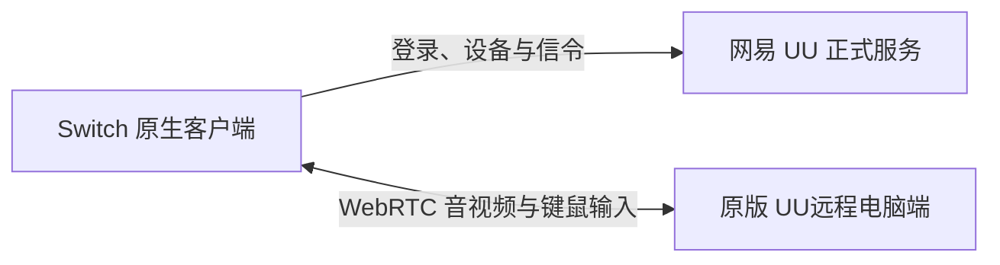

# UU Remote NS

**面向 Nintendo Switch 的原生 UU 远程主控端。**

基于 C++17 / libnx 的非官方自制程序，独立连接网易 UU 正式服务与原版 UU远程电脑端，接收电脑画面和声音，并通过 Joy-Con 或触屏发送键鼠操作。运行时无需额外网关。


[](LICENSE)

[**下载 v0.1.6 实验版**](https://github.com/Antman2023/UURemote-ns/releases/tag/v0.1.6) · [安装使用](#安装使用) · [按键操作](#按键操作) · [源码构建](#源码构建) · [开发记录](docs/development.md)

> **当前为实验版，串流仍需 Switch 真机联调。**
> v0.1.6 修复持续读取信令时 RTC 状态处理延迟、可能先触发超时的问题，并在 Switch TLS 数据读写入口显式保证非阻塞。v0.1.5 真机已收到 Answer 和候选，正式电脑互通仍待复测。保留大二维码、短信登录、首页版本号及分层脱敏诊断。

## 功能与验证状态

当前源码已接入：

- **账号与设备**：大尺寸二维码或短信验证码登录，同步账号下的电脑，选择在线设备连接。
- **画面与声音**：原生 WebRTC 接收 H.264 / Opus；视频优先尝试 NVDEC，无法使用时回退到软件解码。
- **Joy-Con 与触屏**：摇杆鼠标、左右键、滚轮、常用按键和触屏拖动。
- **会话管理**：取消连接、退出账号、连接异常提示，以及失焦或断开时尝试释放输入。

| 验证项目 | 当前结果 |
| --- | --- |
| Switch ARM64 交叉编译、NRO 打包与资源段检查 | 通过 |
| 与参考 Web 实现的签名 / Protobuf 对照、ACK / ICE 和 300 组 WebSocket 数据流测试 | 通过 |
| 本机原生对端间的 ICE、DTLS、SCTP 二进制输入和 SRTP H.264 接收 | 通过 |
| 随机数引擎多线程隔离、状态保留与线程退出清理 | 通过 |
| Horizon SCTP 内部 C / 外部 C++ 地址布局和 ARM64 初始化指令检查 | 通过 |
| 禁用线程分离后的域名候选解析、音视频回环和连接清理 | 通过 |
| 候选先于 Offer / Answer 到达时的暂存、应用及五通道音视频回环 | 通过 |
| 连接关闭后迟到的候选 / SDP 与旧候选清理 | 通过 |
| RTC 诊断只保留固定事件与数值错误码 | 通过脱敏回归测试 |
| Switch 真机连接崩溃报告定位 | 已修复随机数状态、线程分离和 SCTP 地址布局兼容问题 |
| v0.1.5 协商超时 | 已收到 Answer / 候选；修复状态处理延迟，待真机复测 |
| 短信实收登录和修复后原版电脑互通 | 待验证 |
| 真机 NVDEC、声音、输入语义、延迟及长时间稳定性 | 待验证 |

默认请求 **1280 × 720 / 30 FPS / H.264**。Joy-Con 使用键鼠映射，尚未实现 UU 原生虚拟 Xbox 手柄协议。

## 安装使用

准备一台能够运行自制程序的 Nintendo Switch，以及已安装原版 UU远程的电脑和手机。Switch 需要联网；手机与电脑使用同一个 UU 账号。

1. 下载 [SD 卡安装包](https://github.com/Antman2023/UURemote-ns/releases/download/v0.1.6/UURemote-ns-0.1.6-switch.zip)，解压到 SD 卡根目录；更新时覆盖原 NRO。
2. 在电脑上打开**原版 UU远程电脑端**，登录账号并保持在线。
3. 更新后先退出旧程序。在 Switch 上按住 **R** 启动一个游戏，进入完整内存模式的 hbmenu，再打开 **UU Remote NS**。首页应显示 **v0.1.6**；若没有，请检查是否启动了其他目录的旧副本。不支持相册小程序模式。
4. 按 **A** 获取大尺寸二维码，使用手机官方 UU远程 App 扫码并确认；也可按 **X** 切换短信登录，输入区号、手机号，发送验证码后输入 6 位验证码并选择「登录」。短信界面用 **↑ / ↓** 选择项目，**A** 打开系统数字键盘或确认，重发需等待 60 秒。
5. 选择列表中的在线电脑，按 **A** 连接；远程桌面中按 **−** 断开。

安装后的文件位置：

```text
SD 卡根目录/
└── switch/
    └── UURemote-ns/
        └── UURemote-ns.nro
```

也可下载 [单独的 NRO](https://github.com/Antman2023/UURemote-ns/releases/download/v0.1.6/UURemote-ns.nro)，手动放到上述目录。[SHA256SUMS](https://github.com/Antman2023/UURemote-ns/releases/download/v0.1.6/SHA256SUMS) 用于校验 NRO 和安装包。

账号令牌、手机号和验证码只保存在内存，重启程序后需要重新登录。SD 卡保存随机生成的主控 `client-id` 和连接阶段日志 `connection.log`，包含 ICE / 信令状态、DTLS / SCTP 握手阶段及允许记录的数值错误码；异常终止时还记录异常类型和代码偏移。不记录原始库日志、网络地址、手机号、验证码、令牌、二维码内容、SDP 或数据通道消息。连接时不会强制抢占已有远控会话。

## 按键操作

| 场景 | 按键 | 行为 |
| --- | --- | --- |
| 首页 | ↑ / ↓ · A | 选择电脑 · 确认或扫码登录 |
| 未登录 / 扫码界面 | X | 切换扫码或短信登录 |
| 短信登录 | ↑ / ↓ · A | 选择输入项或按钮 · 输入或确认 |
| 已登录首页 | Y · X · + | 刷新设备 · 退出账号 · 退出程序 |
| 登录或连接中 | B / − | 取消 |
| 远程桌面 | 左摇杆 | 移动鼠标 |
| 远程桌面 | ZR / ZL | 鼠标左键 / 右键 |
| 远程桌面 | 触屏 | 移动鼠标，按住拖动；画面黑边不发送输入 |
| 远程桌面 | 右摇杆上下 | 滚轮 |
| 远程桌面 | A / B / X / Y | Enter / Esc / Space / Tab |
| 远程桌面 | ↑ / ↓ / ← / → | W / S / A / D |
| 远程桌面 | L / R | Ctrl / Shift |
| 远程桌面 | + · − | 显示或隐藏操作说明 · 断开连接 |

## 当前限制

- 未实现应用列表与启动界面、剪贴板或文件传输。
- 网络实现支持 IPv4 与 UDP TURN；不支持 TURN TCP / TLS，也没有自动重连。
- 未实现 H.265、码率 / 分辨率设置和零拷贝显示；NVDEC 路径仍会将硬件帧传回 CPU，转换为 RGBA 后上传 SDL 纹理。
- 音频尚未实现完整抖动缓冲和音画时钟同步，性能及稳定性需要真机测试。

真机联调可按[开发记录中的检查步骤](docs/development.md#真机检查步骤)进行。连接异常时可附上 `switch/UURemote-ns/connection.log`；若程序崩溃，再提供对应 Atmosphère 崩溃报告。原始崩溃报告可能含内存中的凭据，适合私下排查，公开反馈请先脱敏。

## 源码构建

### 获取源码

```sh
git clone https://github.com/Antman2023/UURemote-ns.git
cd UURemote-ns
```

需要 **CMake 3.21+、Ninja、Python 3.12+** 和 devkitPro Switch 工具链。构建时还需自行提供 **UU TV 3.5.0 APK**，用于提取该版本的请求签名材料；仓库不包含 APK 或签名常量。

### Windows

可用 Python **3.14+** 将锁定版本的工具链下载到项目内的 `.tools/`，无需安装到系统目录：

```powershell
python scripts/bootstrap_sdk.py
./scripts/build.ps1 -Apk 'C:\path\to\UURemote-TV-3.5.0.apk'
```

已有 devkitPro 时，设置 `$env:DEVKITPRO` 后直接运行第二条命令即可，无需执行工具链下载脚本。`cmake`、`ninja` 和 `python` 需位于 PATH；构建脚本也会识别项目内已有的 `.tools/ninja/ninja.exe`。

### Linux / macOS

在已有 devkitPro 环境中安装 `switch-dev`、`switch-sdl2`、`switch-sdl2_ttf`、`switch-curl`、`switch-ffmpeg` 和 `switch-libopus`，其余 portlibs 由包依赖带入。然后执行：

```sh
export DEVKITPRO=/opt/devkitpro
python3 scripts/fetch_deps.py
python3 scripts/patch_deps.py
python3 scripts/extract_key.py /absolute/path/to/UURemote-TV-3.5.0.apk
cmake -S . -B build-nx -G Ninja -DCMAKE_TOOLCHAIN_FILE=cmake/switch.cmake -DCMAKE_BUILD_TYPE=Release
cmake --build build-nx -j6
python3 scripts/package.py
```

已验证的交叉编译环境为 Windows、devkitA64 r30 / GCC 16.1.0、libnx 4.12.0；Linux / macOS 构建步骤尚未在本项目中实测。

构建输出：

| 路径 | 内容 |
| --- | --- |
| `build-nx/UURemote-ns.nro` | Switch 可执行文件 |
| `dist/UURemote-ns-0.1.6-switch.zip` | SD 卡安装包、说明和许可证 |
| `dist/SHA256SUMS` | NRO 与安装包校验值 |

第三方源码版本与 SHA256 记录在 [sources.lock.json](scripts/sources.lock.json)，Windows 工具链包记录在 [sdk-windows.lock.json](scripts/sdk-windows.lock.json)。依赖下载到 `external/`，Horizon 平台补丁由 [patch_deps.py](scripts/patch_deps.py) 应用。

### 本机测试

以下测试使用**本机 C / C++ 编译器**，不需要 Switch、APK 或 UU 账号。首次运行前，先在仓库根目录执行 `python scripts/fetch_deps.py` 下载源码依赖。

```sh
# 协议回归
cmake -S . -B build-protocol -G Ninja -DUU_CORE_ONLY=ON -DCMAKE_BUILD_TYPE=Release
cmake --build build-protocol
ctest --test-dir build-protocol --output-on-failure

# 原生 WebRTC 回环
cmake -S . -B build-rtc-test -G Ninja -DUU_RTC_TESTS=ON -DCMAKE_BUILD_TYPE=Release
cmake --build build-rtc-test
ctest --test-dir build-rtc-test --output-on-failure
```

回环测试仅使用本机两个原生对端，不连接正式 UU 房间，不能替代 Switch 与原版电脑端的兼容性验证。

## 技术结构



客户端使用 libcurl 处理 HTTPS / TLS WebSocket，libdatachannel 及其依赖处理 WebRTC，FFmpeg / Opus 负责解码，SDL2 负责显示与音频输出。中文使用系统共享字体。协议移植参考 `UURemote-web`，保留其已验证的请求签名、连接参数及信令封装。

实现细节、源码位置与真机检查步骤见 [开发记录](docs/development.md)。

## 许可证与声明

项目代码采用 [GPL-3.0-or-later](LICENSE)，依赖的授权信息见 [THIRD_PARTY.md](THIRD_PARTY.md)。

签名材料在本机构建时从用户提供的 APK 提取，写入被 Git 忽略的 `romfs/signing.key`，并嵌入生成的 NRO；它不是能够在客户端保密的密钥。APK、UU 品牌和协议归原权利人所有。本项目非网易官方客户端，与网易无隶属或背书关系。
